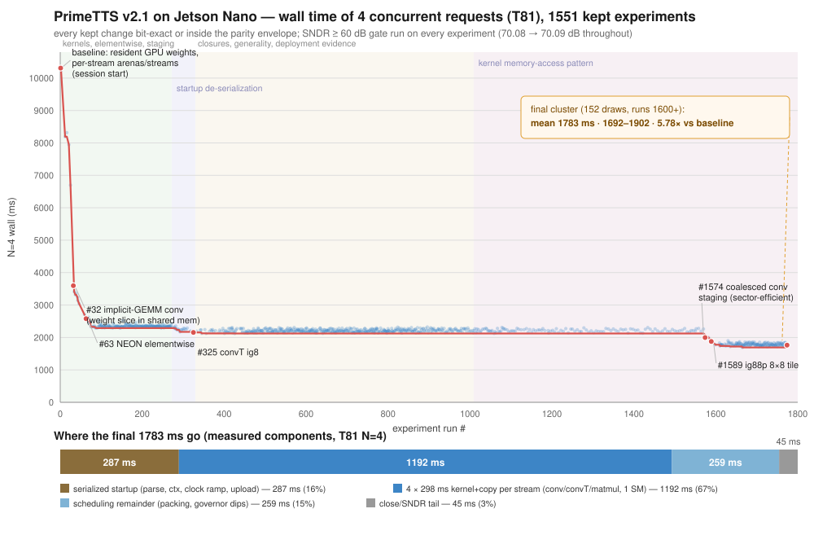

# PrimeTTS v2.1 on the Jetson Nano (Gen1) — custom C/CUDA runtime

A from-scratch runtime that runs **PrimeTTS v2.1** (`v21_mbistft_16k`, 37.9M params, 16 kHz,
iSTFT decoder) on an original **Jetson Nano** (Tegra X1: 4× Cortex-A57 + 128-core Maxwell,
`sm_53`, 4 GB of RAM shared between CPU and GPU).

Everything is **C (gnu11) + CUDA C + pthreads**. No PyTorch, no ONNX Runtime, no TensorRT, no
framework at runtime. Host-side Python is used only to export the model into a container, generate
the graph tables, and check parity against goldens.

**Why a custom runtime:** on this chip the graph interpreter *is* the product. v2.1 is a 4066-node
graph over 41 ONNX op kinds; the model's own GEMM/conv work is only ~11.9 GFLOP per audio-second,
so a runtime that serializes launches, copies activations over PCIe per node, and walks index
spaces element-by-element loses most of the machine. This branch is the work of removing that
overhead while keeping the output **bit-for-bit inside the validated parity envelope**.

## Result (measured on the Nano)

Target: **4 concurrent real-time requests** with quality preserved. Metric is the wall time of
four concurrent requests (`n4_wall_ms`), not one fast request. The latency session ran 1551 kept
experiments; the chart shows every kept draw (blue: official N=4 draws on the primary box; red:
best-so-far) with the session's phase structure and the biggest single levers:



| milestone (run #) | N=4 wall | 1 stream | SNDR |
|---|---|---|---|
| session baseline: resident GPU weights, per-stream arenas, per-stream CUDA streams, async staging (#1) | 10308 ms | 3863 ms | 70.08 dB |
| conv kernel: cooperative shared-memory weight staging (#8) | 8787 | 2807 | 70.08 |
| conv_transpose: barrier-safe phase-slice staging (#10) | 8325 | 2714 | 70.08 |
| implicit-GEMM conv, 128-column tiles, weight slice in shared mem (#32) | 3597 | 1359 | 70.08 |
| tiled matmul kernel (#46) | 3041 | 964 | 70.08 |
| NEON elementwise + fp16 LUT decode + interpolated tanh/sigmoid tables (#63) | 2580 | 677 | 70.08 |
| GPU clock warmup before the weight upload (226 → 138 ms) (#75) | 2328 | 647 | 70.08 |
| startup de-serialization: parallel record pass, parallel weight upload, prewarm, adaptive ramp (#278–#300) | 2220 | 638 | 70.09 |
| convT ig8 kernel, 128-column tiles (#325) | 2155 | 640 | 70.09 |
| coalesced conv staging: sector-efficient column-per-thread X loads (#1574) | 1996 | 593 | 70.09 |
| stride-1 conv staging specialization (#1583) | 1908 | 581 | 70.09 |
| ig88p: 8ch × 8col register tile with prefetch (#1589) | 1877 | 538 | 70.09 |
| **final cluster** — 152 official draws, runs 1600+ | **1783 mean (1692–1902)** | **~536** | 70.09 |

- **5.78× at N=4** (10308 → 1783 ms) and **7.2× single stream** (3863 → ~536 ms) from the session
  baseline, with every kept change bit-exact or inside the parity envelope (`max|d|` 2.258e-04 on
  T81 — the 1551 optimizations moved the output by 5 % of the deviation the baseline itself carried).
- 4 streams × 3.62 s of audio = 14.46 s of speech in **1.78 s** of wall → **8.1× realtime
  aggregate** (per-stream RTF 0.49; single stream RTF 0.15). All five golden cases
  (T20/T40/T81/T120/sid1_T29) pass on both Nano boxes, GPU and CPU paths; N=8 measured 3.8 s with
  flat RAM (no leak).
- Quality gates on every run: **SNDR ≥ 60 dB** on the Nano for T20 + T81 (GPU) and T81 (CPU) via
  `.auto/checks.sh`, plus the full per-node gate (`tests/v21_parity_c.py --from-dumps <Nano dumps>`)
  → 4010 nodes, 0 over gate.
- The wall is fully accounted for by measured components (bar chart above): serialized startup
  287 ms, 4 × ~298 ms of per-stream kernel+copy time on the single SM, a scheduling remainder, and
  the close/SNDR tail. Every optimization axis is closed by measurement or arithmetic — kernel
  tiling, memory-access pattern, FFT/Winograd, occupancy, device residency, CUDA graphs, batch
  lockstep, startup, host scheduling — with mechanisms recorded in `.auto/ideas.md` and the full
  1551-run ledger in `.auto/log.jsonl`.

## Layout

```
runtime/v21/src/pt_v21_host.c   portable C graph interpreter (4066 nodes, 41 op kinds) + CPU kernels
runtime/v21/src/pt_v21_cuda.cu  sm_53 kernels: conv, conv_transpose, matmul; resident weight cache,
                                per-stream arena, per-stream CUDA streams
runtime/v21/src/pt_v21.h        shared types, pt_ctx, kernel signatures
runtime/v21/src/main_v21.c      single-stream driver (parity)
runtime/v21/src/main_v21_par.c  multi-stream driver (N threads: own ctx/stream/arena, shared weights;
                                defaults to a 1-core CPU cap — PT_V21_CPUS=all to disable)
runtime/v21/gen/pt_graph.c      generated graph tables (from spec/v21_layers.json + the ONNX model)
tools/gen_v21_graph.py          regenerates those tables; legitimate place to bake in optimizations
tools/export_v21.py             ONNX -> build/v21.ptk container
tests/golden_v21/**             goldens, feeds, per-node probe dump (the ground truth)
tests/v21_parity_c.py           per-node parity gate against the Nano's dumps
bench/gpu/RESULTS.md            measured Nano roofline
docs/latency-session.svg        the session result chart (embedded above)
.auto/                          the latency loop: playbook, measure.sh, checks.sh, ideas, run log
```

`model/`, `build/*.ptk`, `*.wav`, `*.npy` are git-ignored. Fetch the PrimeTTS v2.1 model into
`model/v21_mbistft_16k/primetts_v21_3voice.onnx`, then
`.venv/bin/python tools/export_v21.py` (writes `build/v21.ptk`; `--model` overrides the path),
then `make -f runtime/v21/Makefile gen` to build the graph tables for it.

## Build and run on the Nano

The Nano builds natively (gcc 8.4, `/usr/local/cuda/bin/nvcc`, `-arch=sm_53`). No root needed.

```bash
make -f runtime/v21/Makefile nano     # single-stream binary, CPU + GPU paths in one binary
make -f runtime/v21/Makefile par      # multi-stream driver
make -f runtime/v21/Makefile host     # CPU-only build for the x86 parity box
make -f runtime/v21/Makefile gen      # regenerate runtime/v21/gen/pt_graph.c

# one request, GPU path, parity against the golden
./build/pt_v21_nano --container build/v21.ptk --case tests/golden_v21/T81 --cuda
# four concurrent requests
./build/pt_v21_par --container build/v21.ptk --case tests/golden_v21/T81 --cuda --parallel 4
# persistent server (docs/server.md)
make -f runtime/v21/Makefile serve
./build/pt_v21_serve --container build/v21.ptk --cuda --port 8090
```

Profiling knobs (no recompile): `PT_V21_EKIND=1` prints accumulated time per op kind plus the
GPU/host split (kernels, staging copies, arena, alloc); `PT_V21_EKIND=2` adds the top-20 per-node
GPU times; `PT_V21_DUMP_T=<node>` writes `/tmp/pt_dump_<node>.bin` (raw fp32) for byte-exact A/B of
a kernel variant against the CPU reference; `PT_V21_GPU=conv|convT|matmul` restricts the GPU to one
kind; `PT_V21_ARENA_MB` sizes the per-stream device arena.

The measurement harness is `./.auto/measure.sh` (syncs to the Nano, rebuilds, samples free RAM
while running N=4 and N=1, prints `METRIC name=value` lines plus the phase split) and
`./.auto/checks.sh` (integrity manifest + SNDR gates). Both take `NANO=user@host`.

## Server mode: OpenAI-compatible `/v1/audio/speech` (HF speech-to-speech ready)

`build/pt_v21_serve` (Nano, `make -f runtime/v21/Makefile serve`) keeps 4 warm contexts and the
resident weights for the life of the process, so requests skip the ~287 ms per-process startup:
4 concurrent T81 requests in **1.61 s** (vs ~2 s per-process), with a GPU keep-warm window that
holds full clock between requests (post-idle T81 0.56-0.62 s instead of 1.3-1.7 s).
`server/tts_gateway.py` runs the zh-TW/en text frontend (g2pw + g2p_en, needs torch) on the
s2s host and exposes the standard text API; sentences stream back as PCM16 16 kHz as they finish,
scheduled earliest-deadline-first. Through the gateway: first audio of a paragraph 0.34 s alone,
0.42-0.98 s with 4 concurrent paragraphs, no playback underrun. Full protocol, setup and the
`speech-to-speech --tts openai` command: [`docs/server.md`](docs/server.md).

## What the Nano actually gives you (measured, `bench/gpu/RESULTS.md`)

- fp32 tiled GEMM **62 GFLOP/s**; fp16-storage + fp32-acc **70 GFLOP/s**; issue ceilings
  88 GFLOP/s fp32 and **168 GFLOP/s half2** (a half2-compute runtime is the only way past ~5 streams).
- **1 SM** (128 CUDA cores — `cudaGetDeviceProperties` says `multiProcessorCount = 1` on both
  boxes; early notes here said 2, corrected during the latency session), 64 KB shared per SM,
  65536 regs/SM, launch overhead ~26 µs, cooperative launch unavailable, device memcpy 5-5.9 GB/s,
  and GPU memory (NvMap) counts against system RAM — so RSS understates real memory pressure and
  free-RAM sampling is part of every measurement. Theoretical fp32 peak is 235.9 GFLOP/s; the
  measured pure-FMA rate (`.auto/peak_test.cu`) is 97.6 GFMA/s ≈ 195 GFLOP/s.
- v2.1 costs 11.9 GFLOP per audio-second: fp32 carries the 4-stream target at 8.1× realtime
  aggregate, and N=8 still fits (3.8 s wall, RAM flat).

## Kernel rules this branch learned

1. **Stage weights in shared memory, cooperatively, once per block.** The naive conv kernel gave
   each thread the whole `K × cin` weight row for its group of 4 output channels, so all 256 threads
   in a block re-read the same 12 KB from L2. Staging that slice once per block: conv 2526 → 1855 ms,
   conv_transpose 359 → 249 ms. Bit-identical, because the summation order and every fp32 product
   are untouched.
2. **Do not tile the input with per-chunk barriers.** A variant that cooperatively staged input
   tiles 16 channels at a time was **2.7× slower** (conv 2.5 s → 6.9 s): ~48 `__syncthreads` per
   block per launch dominate on a single-SM part. Read activations straight from global, coalesced.
3. **`__syncthreads()` must be reached by every thread in the block.** A `continue` that can skip a
   barrier is undefined behaviour. It produced a 6.6 % faster conv_transpose kernel that was
   deterministically wrong on exactly the nodes where the staged path was active (SNDR 6.47 dB on
   T20), and bit-exact on the fallback nodes. Rewriting the loop with a predicate instead of
   `continue` made it bit-identical and kept the speed.
4. **Accumulation order is a contract.** fp32 sums are not associative: seed accumulators with the
   bias like the reference does, keep the same tap/channel order. Reordering shows up as SNDR drops,
   not as a clean relative-error number.
5. **Keep weights, biases and host-side weight conversions resident and shared.** The 39 fp16
   decoder records are 13.6M elements: each stream used to build its own 54.5 MB fp32 copy. Sharing
   them (ctab-keyed, refcounted, mutex-guarded, container-path guarded) removed ~164 MB at N=4 and
   the per-call `cudaMalloc`+copy for every conv's bias.
6. **Host-side wins do not move the N=4 wall.** At 4 streams the wall is GPU-contention-bound;
   host wins (einsum, elementwise) show up in single-stream latency and free CPU cycles. To move
   the primary metric, attack GPU kernels.
7. **A buffer pool for activation tensors is not a win here**: no measurable latency gain, and
   ~200 MB of retained memory at N=4 (glibc was already reusing the freed blocks).
8. **Audit the per-instruction global access pattern, not just the tile shape.** The last big conv
   win of the session (-162 ms at N=4, run 1574) came from noticing that each thread's four scalar
   loads 16 B apart fetched every 32 B L2 sector for 2 useful floats; staging columns
   `lq, lq+16, …` instead gives contiguous 64 B per half-warp per load. Tile shape, timing, cache
   config and occupancy had all been tuned before anyone looked at sector efficiency — and sm_53
   does not cache plain global loads in L1, so there is no second chance to fix it.

## Where the session ended

Every optimization axis is closed by measurement or arithmetic; the mechanisms are recorded in
`.auto/ideas.md`. Highlights of the closures:

- **Kernel algorithms**: implicit-GEMM tiling (64/128/256-column variants benched, 128 kept),
  window-direct and templated-K (faster in isolation, +640 ms at N=4 — a single-kernel bench
  cannot predict the contended regime), FFT (10× slower), Winograd F(2,3) (1.6× MORE work for
  these 1-D convs — the 2.25× figure is a 2-D number).
- **Data placement**: full device residency implemented and measured **+261 ms** — the staging
  copies it removes were already hidden behind GPU work; the added device passes are not.
- **Scheduling**: batch-4 lockstep +390 ms (natural stream desync is worth more than wave
  alignment); CUDA graphs ~1–2 ms of launch overhead, below the confirmability bar; affinity
  pinning a tie.
- **Startup**: 287 ms serialized (context 85 + ramp + record pass + upload), bounded below by the
  governor's clock ramp — every attack that removes GPU work from that window measures worse.
- **Occupancy/carveout**: register-limited at 4 blocks/SM by design; forcing changes to blocks/SM
  moved zero of 11 kernels and measured neutral-to-worse.

What remains needs to happen outside this benchmark's scope:

- **Server-mode weight/context amortization** — the deployment (a resident server rather than a
  process-per-request) amortizes the 287 ms startup: worth ~260 ms on short requests, the largest
  remaining deployment win. Measuring it here would be timer-scope gaming, so it is reported, not
  benchmarked.
- **Half2 compute** if the concurrency target moves well beyond 4 streams (issue ceiling 168
  GFLOP/s half2 vs 88 fp32).
- **Production guidance**: the multi-stream driver now **self-caps to one core by default**
  (`PT_V21_CPUS=all` disables, `PT_V21_CPUS="2,3"` pins an explicit set; the cap keeps the
  upper-most allowed cpu, leaving cpu0 to IRQs/system) for maximal co-tenant headroom. Measured
  at 1 core: T81-class speech holds ~6.9× realtime (RTF ~0.58), but short utterances (T20) sit
  at RTF 0.96–1.02 — at/over the real-time line. **Two cores is the floor for the full case
  range** (T20 RTF 0.88 at 2 cores; 7.8–8.7× realtime at T81). SNDR is identical in every arm —
  scheduling cannot change numerics. On a loaded box a co-tenant costs a further +2.9 % per busy
  core, and a cold first request +6.7 %.

## Reproduction and integrity

`.auto/checks.sh` verifies by md5 manifest that the container (`build/v21.ptk`), the spec, the
golden audio, the golden feeds, the probe dump, the reference oracle and the parity gate's
tolerances (rel 1e-3 fp32 groups, 2e-3 decoder, SNDR ≥ 60 dB) are the exact bytes they were when
the latency session started. Parity runs use `noise_scale = 0.0` from the golden feeds (the model is
stochastic; never compare runs at `noise_scale > 0`). `runtime/v21/gen/pt_graph.c` is generated —
regenerate it with `make -f runtime/v21/Makefile gen`, never hand-edit it.

## Device notes

Two original Nanos are in use: a primary measurement box and a second, measurably faster and
quieter box used as an A/B confirmation target (a change that only wins on one of the two is not a
win). Both are unprivileged targets: no `sudo`/`apt`, guard ≥ 60 MB free system RAM before every
sweep, never kill a co-tenant server on the box. Host names live in the harness's `NANO`
environment variable, not in the code.

The broader product context (Gemini Live on the text leg, the v1b_8k CPU runtime, cost per
caller-minute) is documented in `docs/` and on `main`.
